# Does the AmphiBac workflow predict Bd-inhibitory function? A summary of all tests to date

## Bottom line

The AmphiBac database is internally consistent. The common way it is used, however — closed-reference matching of amplicon features at 99% identity, then counting "inhibitory" reads — does not recover Bd-inhibitory function. The main reasons:

1. **Isolate labels are not shared by identical 16S sequences.** 69–74% of groups of identical fragments contain conflicting Bd labels.
2. **Prediction of a held-out isolate's label is near chance once whole studies are held out.** Cohen's κ is about 0.1 for the pipeline's rules, at every fragment length, region and threshold tested.
3. **Genus alone predicts as well as, or better than, any 16S-identity rule.** This holds for V4 up to a 1,100-bp V2–V8 window.
4. **The per-sample "inhibitory proportion" is indistinguishable from what random labels give.** It measures how much of the community has a cultured relative in the database (ρ = 0.92–0.97 with the shuffled-label value).
5. **No metric tracked Bd infection or load** in either Bd dataset, once site and season (or treatment) were accounted for. A naive analysis of the leopard-frog data does find a significant association, but in the *opposite* direction, and it is driven by site.
6. **The practice is common and inconsistent.** At least 57 of the 116 citing papers whose methods could be read matched their own sequences to the database. Their matching rules range from genus name only to 100% identity.

## Cohen's K use

Cohen's κ is the score I used throughout for one question: **does a 16S match predict an isolate's own lab-measured Bd label better than chance would?**

What is being compared

Every κ in the reports comes from the same isolate-level test:

Take one AmphiBac isolate whose Bd function was measured, so its label (Inhibitory or not) is known.

Remove it, and in the stricter version also every other isolate from the same study.

Cut its 16S down to the amplicon fragment being tested (for example 120 bp of V4) and run it against the remaining database with the rule being tested.

The rule gives a prediction: "inhibitory" or "not inhibitory".

Compare the prediction with the isolate's real label.

Repeating this for about 5,000–6,600 isolates gives a 2 × 2 table of predicted against measured labels. κ summarises how well they agree.

The rules compared:

**R1:** the label of vsearch's default top hit.

**R2:** any hit to the Inhibitory subset, which is the pipeline's logic.

**R3:** any hit to the InhibitoryStrict subset.

**R4:** the majority label among all ≥99% hits.

Genus baseline: the majority label of the isolate's genus.

Why κ and not plain accuracy

κ asks how much better the agreement is than you would get by chance, given how often each label occurs:

κ = (observed agreement − agreement expected by chance) / (1 − agreement expected by chance)

κ = 0: no better than guessing with the same label frequencies.

κ = 1: perfect agreement.

κ < 0: worse than chance.

Plain accuracy or sensitivity is misleading here because the pipeline calls almost everything inhibitory. The 120 bp, 99%, 

R2 run shows this (one isolate held out at a time):

## 1. Workflow and data tested

**The workflow.** We tested the `tools/antifungal_predictions_pipeline.py` script and the older `scripts/Antifungal_Predictions_conda.sh` from github.com/AmphiBac/AmphiBac-Database. Both run:

```
qiime vsearch cluster-features-closed-reference --p-perc-identity 0.99 --p-strand both
```

against one of four subsets: Full (8,739 sequences), Inhibitory (2,831), InhibitoryStrict (2,273) and Facilitating (645). They then report per-sample Total, Proportion and Richness.

q2-vsearch sets no `maxaccepts`, `maxrejects` or coverage options, so vsearch's defaults apply:

- the first k-mer-ranked hit that passes the threshold is accepted;
- terminal gaps are ignored when computing identity;
- there is no minimum query coverage.

We reproduced this exactly with vsearch 2.32.0. QIIME itself was not run.

| Data | Use |
|---|---|
| AmphiBac 2025.1 (qza = FASTA, 8,739 seqs), plus releases 2020.6 and 2023.2 | Isolate-level tests and release stability |
| Amphibian meta-analysis: 2,411 samples, 48,431 deblur sOTUs (90 bp) | Real-data impact and permutation null |
| Bullfrog nitrogen experiment: 40 frogs, 10 ponds, 3,700 ASVs (120 bp), Bd loads | Real-data impact and Bd validation |
| SERDP leopard frogs: 372 frogs, 6 species-sites, 4 seasons, 12,105 sequenced features (150 bp), Bd loads (100 infected) | Large-scale Bd validation |
| In-silico fragments cut from isolates: 90 / 100 / 120 / 150 bp, V4, V3–V4, and ten *E. coli*-coordinate windows of 254–1,100 bp | Length, threshold and region tests |

**Ground truth.** Each isolate's `AntiFungal.Function.with.AP.function` label, which is the column that defines the subsets. Using `Bd.Inhibition` instead gave the same conclusions.

## 2. The database itself

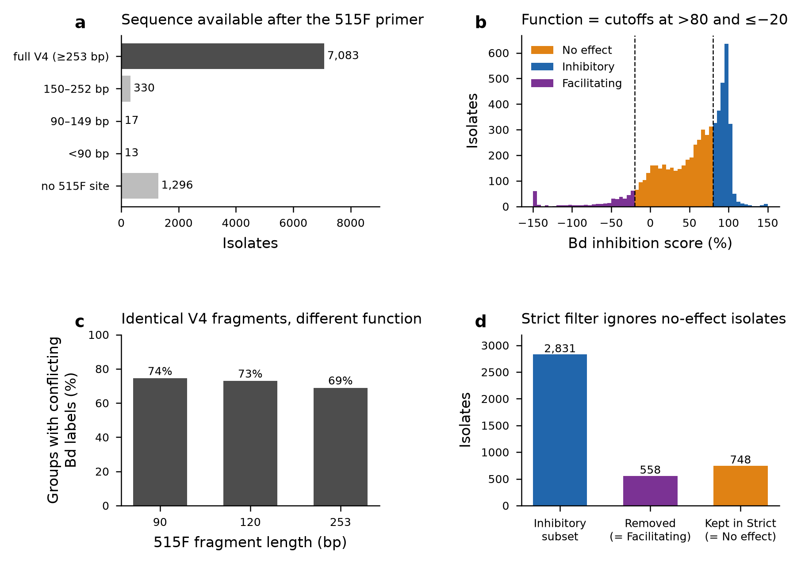

- **Labels are a hard cutoff on a continuous score.** Inhibitory means a CFS score above 80, Facilitating means −20 or below, and everything else is NoEffect. As a result, 790 isolates that the original study called inhibitory are labelled NoEffect.
- **Identical sequences carry different functions.** Among identical 515F fragments with ≥2 labelled isolates, 74% of groups (90 bp), 73% (120 bp) and 69% (253 bp) contain conflicting labels.
- **InhibitoryStrict removes only Facilitating look-alikes.** It drops just the 558 Inhibitory sequences that are 100% identical to a Facilitating isolate, a rule we reproduced exactly. Yet 748 of the 2,273 Strict sequences are 100% identical to a NoEffect isolate.
- **Sequence-format problems:**
  - 5,451 sequences are stored reverse-complemented.
  - 1,296 have no 515F site.
  - 61 placeholder sequences of 2–8 bp can never be hit.
  - 1,355 contain IUPAC codes.
  - `Assay.Method` contains auto-fill errors (from "97 well" through "223 well CFS assay").
- **Coverage along 16S.** Most sequences are Sanger reads spanning *E. coli* positions about 90–870. The largest common window is V3–V4 (296–795, 500 bp), which 6,037 tested isolates (77%, from 27 of 30 studies) span without IUPAC codes. Beyond about 600 bp, coverage collapses and the surviving set becomes biased toward long-read studies (45–51% inhibitory vs 38%).

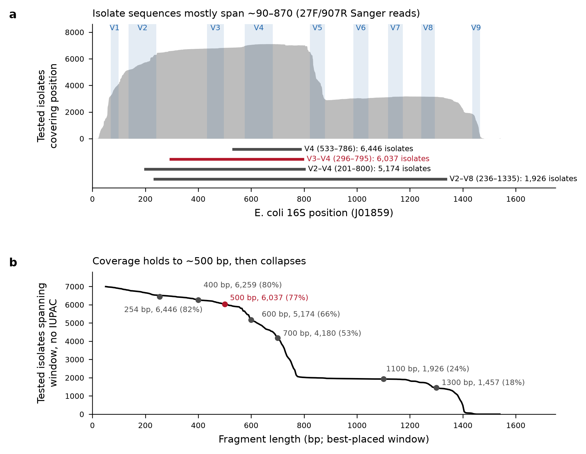

## 3. How vsearch picks a "top match"

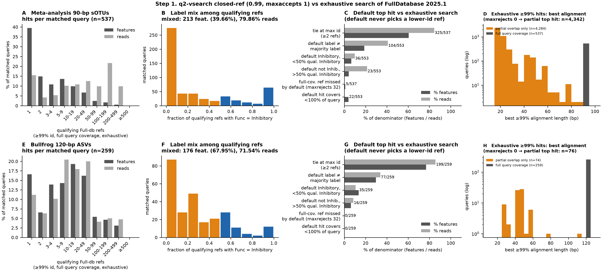

- **The default never picks a lower-identity reference, but ties are the norm.** At the top identity, 61% of matched meta-analysis sOTUs (85% of matched reads) and 77% of bullfrog ASVs have ≥2 tied references. In the longer windows the tie rate is 79–99%.
- **Which tied reference wins depends on file order.** Across 10 shuffles of the reference FASTA:
  - the assigned reference changed for 34% of matched sOTUs (67% of matched reads);
  - the inhibitory yes/no call changed for 14% of sOTUs (26% of matched reads);
  - in the bullfrog data, the call changed for 18% of ASVs;
  - in longer windows, 7–39% of calls changed.

  Thread count changed nothing.
- **Mixed labels are common among qualifying references.** 40% of matched sOTUs (80% of matched reads) have both inhibitory and non-inhibitory references at ≥99%. The default label disagrees with the majority label for 104 of 553 meta-analysis hits.
- **Partial-coverage references pass at "100%".** Because terminal gaps are ignored, a reference covering only 20–40 bp of a 90-bp query passes the 99% threshold. In real data, 22 of 553 default hits are partial. In windows of 400 bp and longer, 36–77% of qualifying hits are partial.
- **Strand matters.** With q2-vsearch's own default (`--strand plus`), 294 of 553 meta-analysis hits are lost. The AmphiBac scripts do set `both`.
- **Ambiguity codes.** N and compatible IUPAC codes score as matches.
- **Missed matches.** The default `maxrejects 32` almost never misses a genuine full-coverage match (5 of 537).

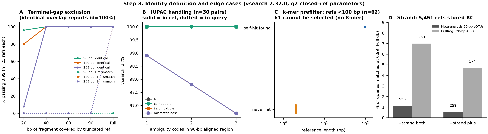

## 4. Thresholds and fragment length

- **The same percentage means different mismatches at different lengths.** 99% identity allows 0 / 1 / 1 / 1 / 2 / 4 mismatches at 90 / 100 / 120 / 150 / 253 / 429 bp, and up to 11 at 1,100 bp. **At 90 bp, 99% is identical to 100%**: every per-sample output was the same.
- **Leave-one-out prediction at 120 bp and 99%, holding out only the isolate itself:**
  - Inhibitory-subset mode: sensitivity 0.94, **specificity 0.15**, PPV 0.40 (prevalence 0.38), κ = 0.07.
  - Default top-hit label: κ = 0.15.
  - Majority vote of all hits: κ = 0.32.
- **Holding out whole studies, every rule falls to κ ≈ 0.09–0.12.** The apparent skill largely comes from isolates in the same study sharing labels.
- **Longer windows: ten regions on a fixed panel of 1,397 isolates, leave-study-out at 99%:**
  - default top hit κ 0.13–0.23;
  - subset rules 0.15–0.31;
  - majority of full-coverage hits 0.27–0.44.

  No region or length beats the **genus-only baseline (κ 0.45)**.

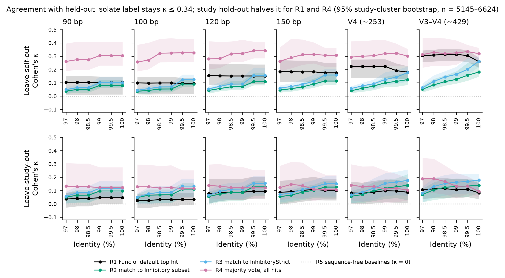

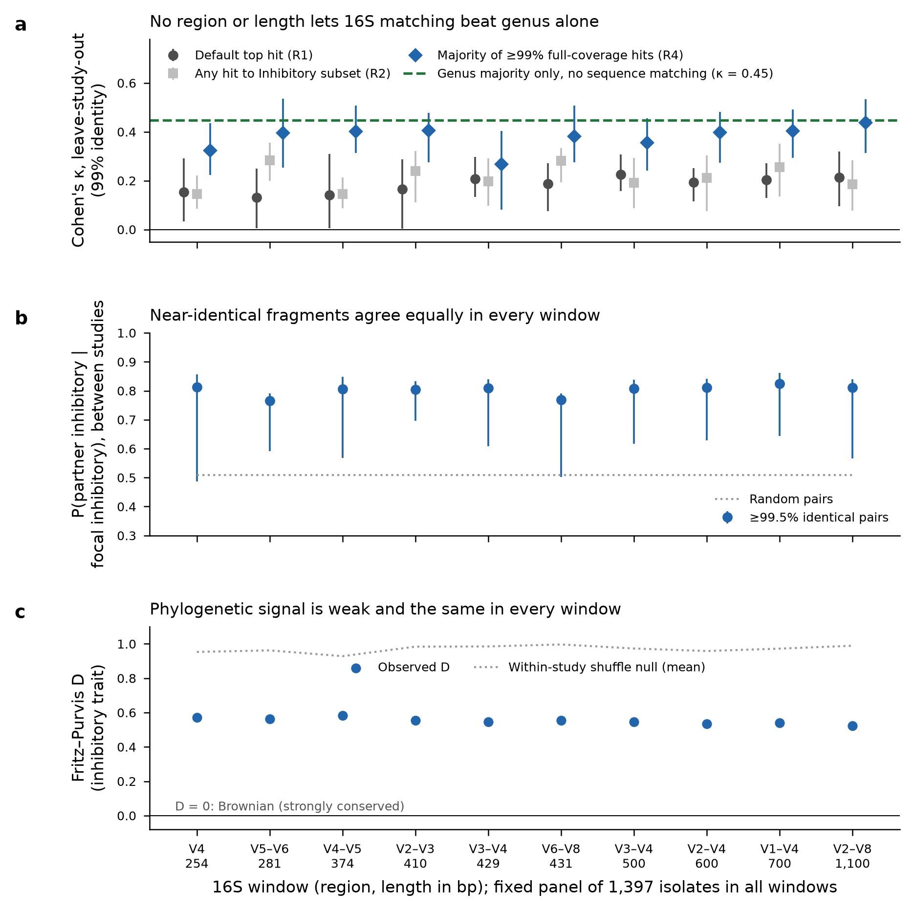

## 5. Does 16S similarity carry functional signal at all?

- **Genus baseline.** Predicting each held-out isolate from its genus's majority label (RDP v18 SINTAX) gives leave-study-out κ 0.21 (120 bp) and 0.25 (V4), against ≤0.12 for every 99% V4 rule. Genera are themselves mixed: 46 of 50 large genera are 10–90% inhibitory, and *Pseudomonas* ranges from 0% to 100% inhibitory between studies.
- **Agreement against sequence difference.**
  - Identical-V4 pairs agree mostly when they come from the same study: κ 0.30 within studies vs 0.09 between.
  - Between studies, P(partner inhibitory | focal inhibitory) is a flat 0.52–0.57 from 0 to 10 V4 differences, then drops to random.
  - On the fixed panel it is 0.77–0.83 at ≥99.5% identity in every window (random pairs 0.51). That is a genus-scale step, not a fine-scale decay.
- **Correction to an earlier result.** Round 2 found that near-full-length identity seemed to help. Round 3 showed this was an isolate-set effect: on the fixed panel, V4 already reaches the same agreement.
- **Phylogenetic signal is weak and the same in every window.** Fritz–Purvis D is 0.52–0.76 (typical conserved microbial traits average about 0.07). τD is not deeper than expected once labels are shuffled within studies. Blomberg's K on the score is about 3×10⁻⁵.

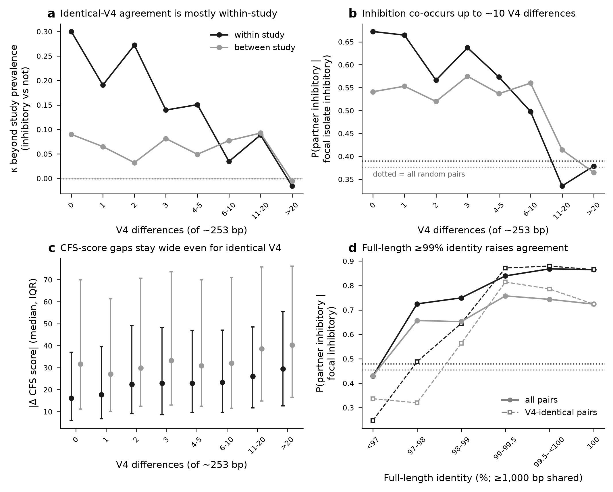

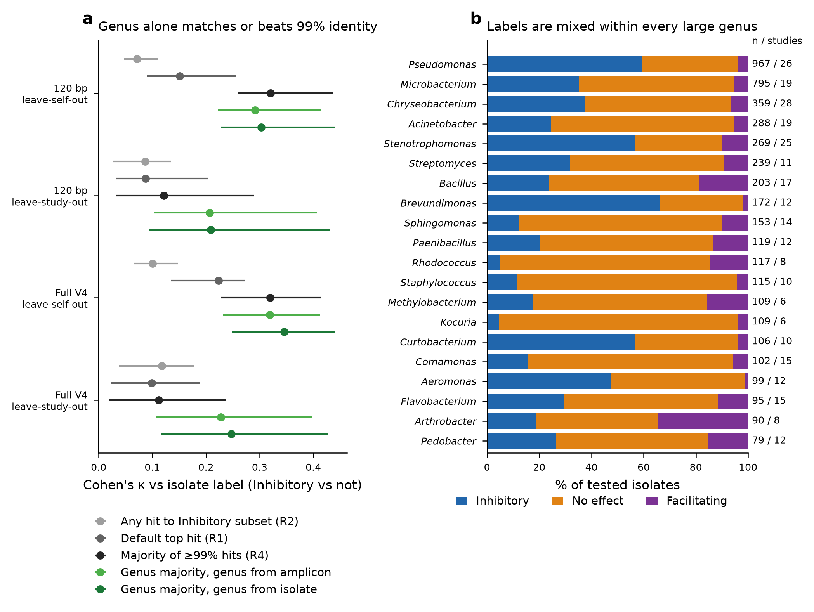

## 6. Database releases and out-of-sample prediction

- **Stable outputs.** Full and Facilitating outputs are stable across releases (ρ ≥ 0.999), and Inhibitory output is nearly stable from 2023.2 to 2025.1 (ρ = 0.995).
- **InhibitoryStrict is not stable from 2020.6 to 2025.1.** 26% of samples shift by more than 0.05 because the subset was redefined; only 1 of 7,382 shared isolates was relabelled. The change flips the *A. boreas* vs *L. catesbeianus* contrast (2020.6: r = −0.20, p = 0.0004; later releases: n.s.), and essentially one reference drives the flip.
- **Top-hit labels drift between releases without new data.** Between 2020.6 and 2023.2, 11% of matched sOTUs changed their top-hit label, mostly through tie-breaking rather than new isolates.
- **Prospective prediction is at chance.** Predicting isolates added after 2020.6 and after 2023.2 from the older release gives κ ≤ 0.15 at 120 bp and V4, and −0.23 to 0.22 in the longer windows. These estimates rest on few studies.

## 7. Impact on real community data

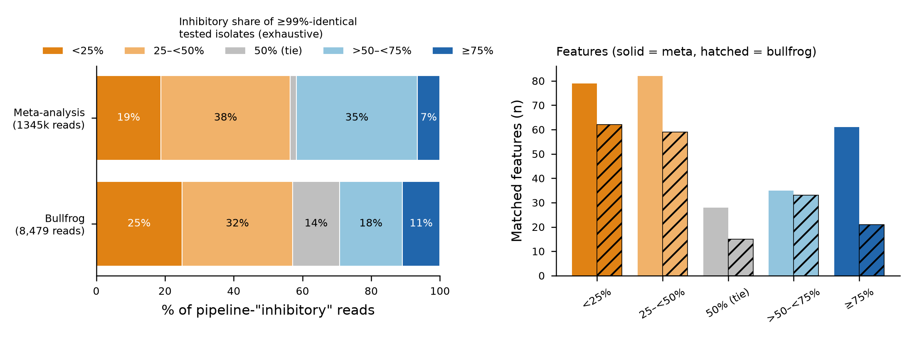

- **Many "inhibitory" reads come from mostly non-inhibitory lineages.** In the meta-analysis, 56% of pipeline-"inhibitory" reads come from features whose ≥99%-identical isolates are mostly non-inhibitory, and 78% come from features that also hit the Facilitating subset. In the SERDP frogs, the median frog has 74% of reads "inhibitory" and 57% "facilitating".
- **The metric tracks cultured coverage.** Inhibitory_Proportion vs Full_Proportion: ρ = 0.947 in the meta-analysis and r = 0.996 in the bullfrogs.
- **Label-permutation null.** We shuffled the labels among database isolates 1,000 times while keeping every sequence match fixed. The observed metric correlates with the shuffled-label mean at ρ = 0.92–0.97. Only 1.9% of meta-analysis samples exceed the null 95th percentile, below the 5% expected by chance; for bullfrogs and SERDP frogs, none do.
- **Host comparisons appear with random labels too.** The adult vs larvae and Madagascar vs USA contrasts are significant in 100% of shuffles.
- **Method choices change conclusions.** *A. boreas* vs *L. catesbeianus* is n.s. under the pipeline but significant under consensus rules. Madagascar vs USA reverses direction under a ≥75%-of-isolates rule.
- **Minor sensitivities.** InhibitoryStrict vs Inhibitory barely matters (ρ = 0.996). Rarefaction seed and thread count are negligible.

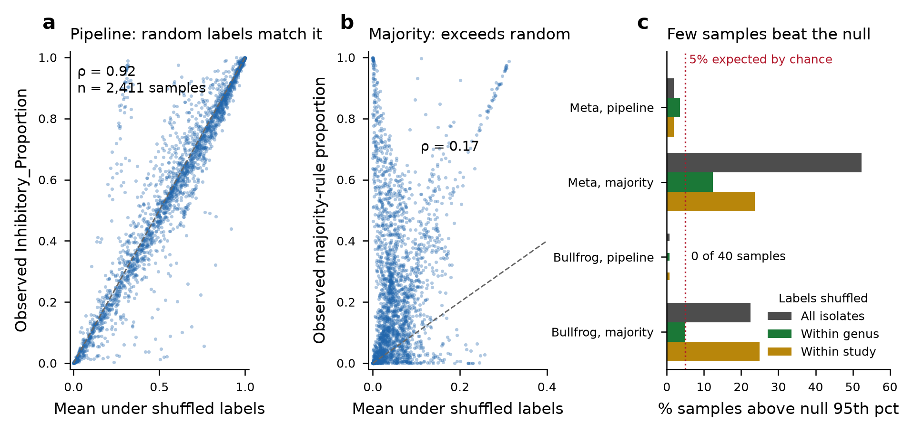

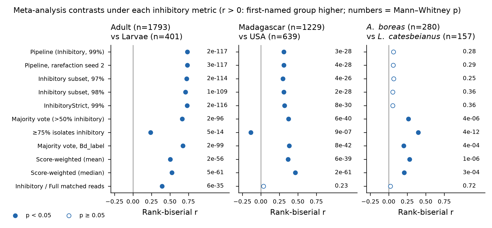

## 8. Validation against Bd infection

**Bullfrog nitrogen experiment** (40 frogs, 10 ponds)

- Bd load is completely separated by treatment, so only within-treatment or pond-level tests are interpretable.
- No AmphiBac metric was associated with log Bd in any analysis: naive, within-treatment, mixed model with pond, or pond means with treatment (15 metrics; minimum BH q = 0.29).
- All 15 naive correlations are positive.
- Power is low: with 10 ponds, only |r| ≥ 0.80 is detectable.

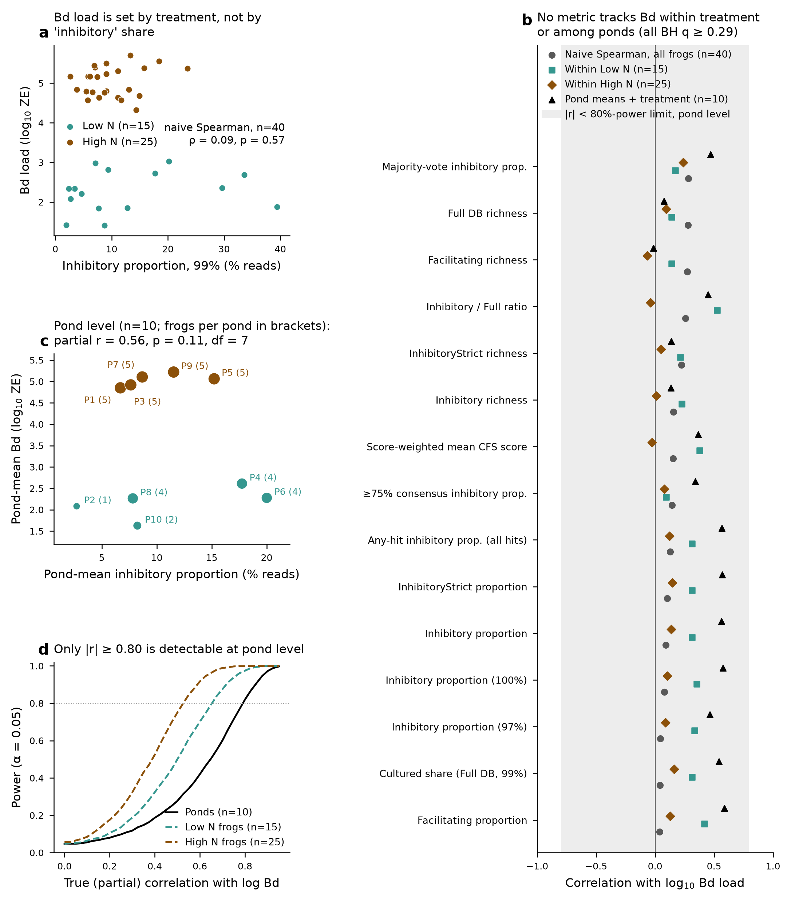

**SERDP leopard frogs** (372 frogs; 100 infected)

- **Naive test.** Infected frogs have *more* "inhibitory" reads (median 0.81 vs 0.70; MWU p = 0.002, q = 0.012).
- **Within site × season** (conditional logit; 344 frogs, 14 strata), no metric predicts infection. For pipeline Inhibitory at 99%, the OR is 1.02 per SD (95% CI 0.72–1.45). The minimum BH q is 0.79.
- **Bd load among infected frogs.** No metric is associated (all p ≥ 0.18).
- **Adjusting for cultured share** changes nothing.
- **Label-permutation null.** The real labels' effect is typical of shuffled labels (71% of shuffles are as or more extreme).
- **Why the naive test is significant.** Sites differ in both prevalence and "inhibitory" share: TN, LA and Panama are high on both, NM and PA low.

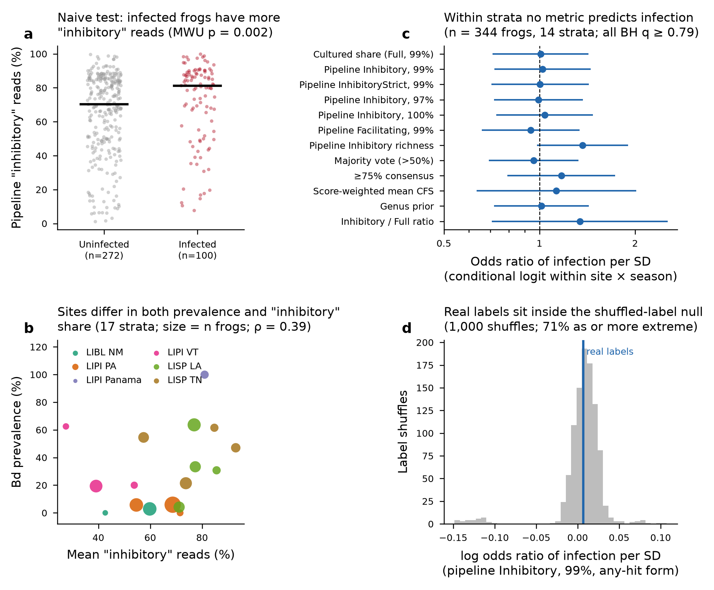

## 8b. Is the score distribution multimodal?

Hartigan's dip test on the 6,245 CFS-scored isolates, with 2,000 bootstraps and a ±0.05 jitter to break ties:

- **Pooled scores are unimodal** (D = 0.0034, p = 0.96). The distribution is left-skewed, with a main mode near 93 and a shallow shoulder near 14; the trough between them is only 4% lower than the shoulder.
- **Within studies**, two of 14 are bimodal after BH correction: AEM.01486-15 (n = 719, modes near 6 and 87) and AEM.00186-17 (n = 119, modes near 15 and 96).
- **Within genera**, none of 29 is bimodal after correction.

The >80 / ≤−20 label cutoffs therefore split one skewed distribution rather than separating natural groups.

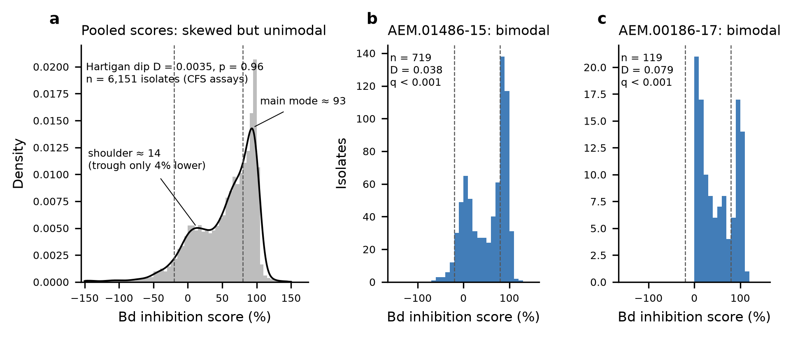

Tables: [score_diptest.xlsx](tables/score_diptest.xlsx), [diptest_by_group.csv](tables/diptest_by_group.csv). Script: [score_diptest.py](scripts/score_diptest.py).

## 8c. Tree-based prediction (PICRUSt2-style placement)

We placed reads into a 7,279-isolate reference tree with EPA-ng and predicted traits with castor hidden-state methods, Brownian/OU score models and a study-aware phylogenetic Gaussian process.

- **Benchmark (30-fold leave-study-out).** No tree-based method beat genus majority or majority voting over ≥99% hits:
  - nearest tip and castor methods: V4 κ 0.11–0.12, AUC 0.57;
  - study-aware phylogenetic model (the only one to tie the baselines): AUC 0.63, against 0.64 for genus majority and 0.62 for majority voting.
- **Variance in the inhibition score:** phylogeny 0.26, study 0.25, Bd genotype 0.08, residual 0.42.
- **Leopard-frog Bd test.** No tree-based metric predicts infection within site × season (OR 0.89–1.27 per SD, all CIs include 1).
- **Shuffled labels.** The observed effects sit inside the null.

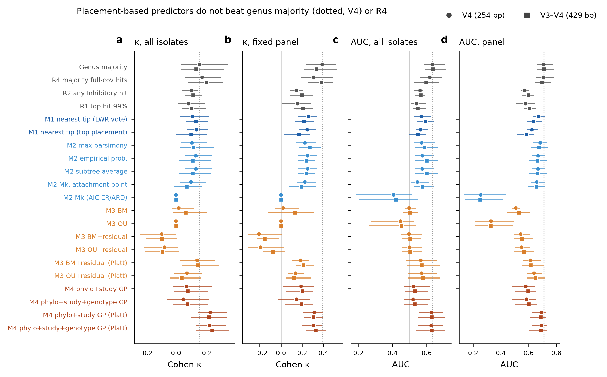

Report: [AmphiBac_placement_method_report.md](reports/AmphiBac_placement_method_report.md).

## 8d. Primer use in amphibian microbiome studies

Of 180 primary studies that state their region:

| Region | Share of studies |
|---|---|
| V4 | 57% |
| V3–V4 | 29% |
| V4–V5 | 5% |
| Others | 9% |

V4 fell from 80% of studies in 2015–17 to 42% in 2024–26. Gut studies favour V3–V4, mostly with 338F/806R.

Report: [amphibian_16S_primer_survey.md](reports/amphibian_16S_primer_survey.md).

## 8e. Host-matched databases and reference-order uncertainty

**Host- or location-matched databases.** Restricting AmphiBac to the study host or location makes predictions worse:
- **Coverage:** there are no Massachusetts bullfrog isolates, and no *R. pipiens* or *R. blairi* isolates. Restriction leaves 55–98% of previously matched reads unmatched in 9 of 11 sets.
- **Partial overlaps:** the remaining matches are often partial overlaps. Every Tennessee *L. sphenocephalus* match covers only part of the 150-bp read.
- **Predictability:** same-host references predict isolate labels worse than all references (κ 0.08 vs 0.28 on the same 551 isolates).
- **Bd:** no restricted metric predicts Bd.

**Reference-order permutations.** We used 10,000 orders, with an emulator of vsearch's k-mer, length and position tie-break validated at 100% agreement against more than 1,200 real shuffled runs.
- **Pipeline metric:** subset-mode Inhibitory_Proportion is exactly order-invariant.
- **Top-hit metrics:** the median 95% width of the top-hit inhibitory share is 0.09 (meta), 0.03 (bullfrog) and 0.25 (SERDP).
- **Conclusions:** no significance call flipped, but effect sizes shifted widely, e.g. adult vs larvae rank-biserial 0.19–0.49.

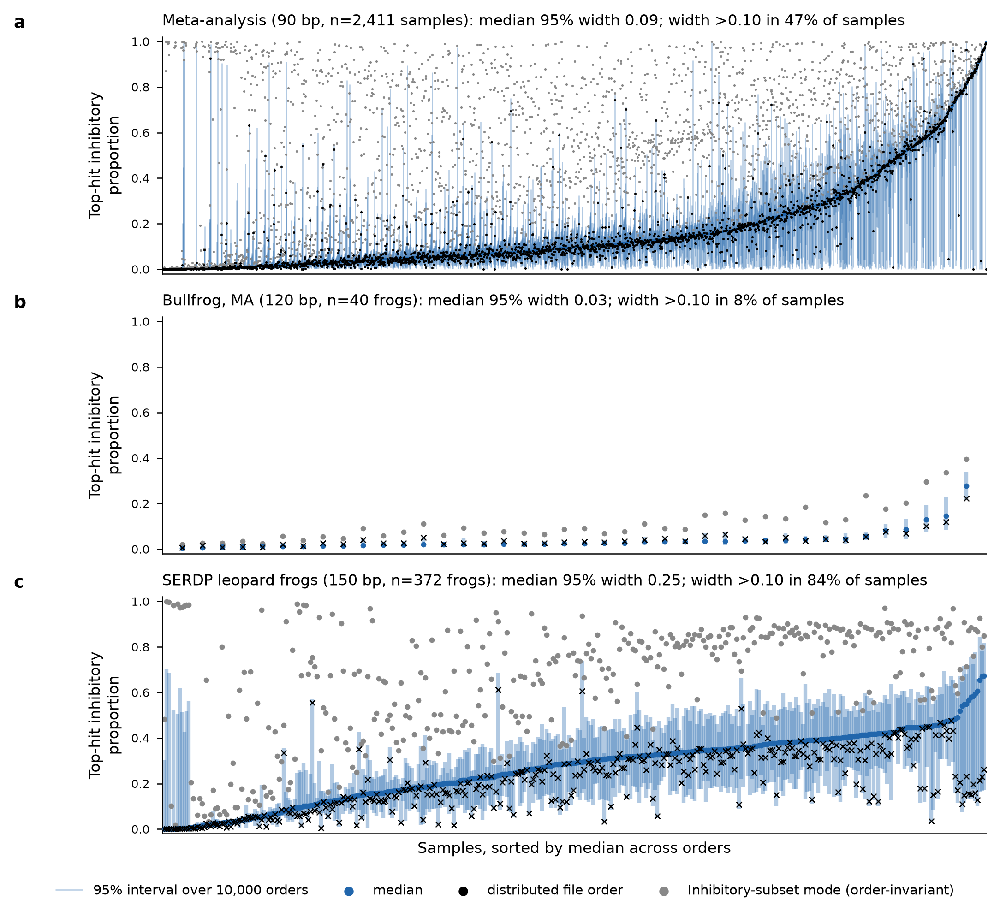

Report: [AmphiBac_hostmatch_order_addendum.md](reports/AmphiBac_hostmatch_order_addendum.md).
## 8f. Worked example: one tied SERDP read through the order permutations

This traces one feature through 1,001 **real** vsearch runs (the distributed order plus 1,000 shuffles, q2-vsearch closed-reference settings): `6a40d31c…`, 150 bp, 6,187 rarefied reads. It is the feature that drives the bimodal SERDP Bd-load slope in 8e.
- **The tie.** The read matches 13 isolates at ≥99%. Six match at 100%, all *L. catesbeianus* isolates from one Virginia study (AEM.01486-15): three Inhibitory (scores 93, 85, 83) and three NoEffect (77, 17, 11). The isolate scoring 77 is NoEffect only because of the 80 cutoff. Seven more match at 99.3% (5 NoEffect, 2 Inhibitory).
- **Which isolate wins.** All six 100% matches share the same number of 8-mers with the read (143), so shorter targets are preferred. Only three ever won: AmphiBac_5440 (Inhibitory, 347/1,001), 5442 (NoEffect, 330) and 5563 (NoEffect, 324). The two 1,270-bp isolates are the shortest overall; 5563 is the shortest of the forward-stored ones. The longer Inhibitory isolates 5506 and 5507 never won.
- **Call rates.** The distributed file order picks 5440, so the default run calls the read Inhibitory. Across orders that happens 35% of the time (emulator: 33%). The pipeline's subset mode calls it Inhibitory 100% of the time.
- **Per frog.** 12 frogs carry the read: 10 infected Panama (Ngäbe-Buglé) frogs, where it makes up to 0.47 of reads, plus two others at ≤0.006. In the three heaviest carriers, the top-hit inhibitory share falls from 0.56–0.61 to 0.09–0.18 when the call switches to NoEffect.
- **Bd load.** Flipping only this call, with every other feature at its default-order call, moves the Bd-load slope among the 100 infected frogs from +0.09 per SD (p = 0.49) to −0.14 (p = 0.30). That single switch spans most of the 10,000-order 95% range (−0.18 to +0.14).

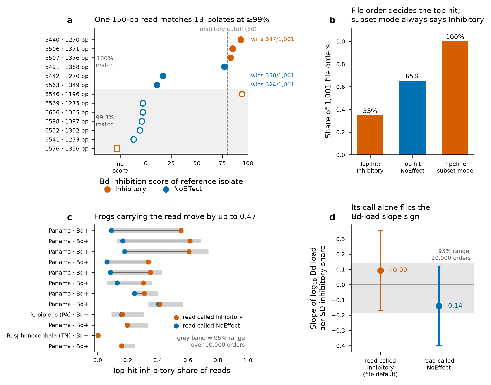

Tables: [tied_feature_references.csv](tables/tied_feature_references.csv), [tied_feature_real_runs.csv](tables/tied_feature_real_runs.csv), [tied_feature_frogs.csv](tables/tied_feature_frogs.csv). Script: [tied_feature_walkthrough.py](scripts/tied_feature_walkthrough.py).

## 8g. How often the database is used to predict function

The survey covers works citing Woodhams et al. 2015 (*Ecology* 96:595, doi 10.1890/14-1837.1). OpenAlex lists 222 citing works. After removing 12 PeerJ peer-review reports and 6 preprint/article duplicates, 204 unique papers remain.
- **Text sources.** Full text came from Europe PMC, Unpaywall and publisher open access. Each paper was classified from its methods and citing passages by a language model, with a second pass on methods sections. The 25 weakest calls were re-run on the whole text. Texts under 10k characters were treated as abstracts.

| Use of the database | Methods read | Abstract only | Total |
|---|---|---|---|
| Predictive: matched own amplicon OTUs/ASVs | 54 | 20 | 74 |
| Predictive: matched own isolate 16S | 3 | 0 | 3 |
| Records used as data (meta-analysis, assays, probiotic choice) | 6 | 8 | 14 |
| Background citation only | 51 | 8 | 59 |
| Cannot tell from the abstract | 2 | 52 | 54 |
| **Total** | 116 | 88 | 204 |

- **Confirmed predictive use: 57 papers**, about half of the 116 whose methods could be read. A further 20 are probable from the abstract alone. The 52 unresolved papers are mostly closed access (Wiley, Springer, *Proc. B*), so the true count is likely 75–90.
- **Growth.** Confirmed predictive papers numbered 1–3 per year in 2016–2019, 5–7 per year in 2020–2022, and 7–11 per year in 2023–2025.
- **No common rule.** Of the 57:
  - 17 used 100% identity, 8 used 99% and 8 used 97–98%;
  - 2 used a lower threshold or only a BLAST e-value;
  - 5 matched by genus or family name without comparing sequences, and 2 used phylogenetic methods;
  - 15 did not state the rule or cited another paper for it.
  
  Only 11 used vsearch, as the current pipeline does. Given sections 3–4, "proportion inhibitory" values from these studies are not directly comparable.
- **Not verified.** The table also records whether each study linked predictions to Bd and whether it ran its own assays. Neither field was audited.
- **Coverage.** Studies that cite only the AmphiBac 2023/2025 releases or the GitHub repository are not counted.

Table: [woodhams2015_citers_classified.csv](tables/woodhams2015_citers_classified.csv). Script: [woodhams2015_citation_survey.py](scripts/woodhams2015_citation_survey.py).

## 9. Recommendations

1. **Report matches as mismatches over the read length, not percent identity.** At 90 bp, 99% means an exact match.
2. **Summarise all qualifying hits instead of the first one.** Use vsearch directly with `--maxaccepts 0 --maxrejects 0`, and report n, % inhibitory, % facilitating and median score per feature.
3. **Require full query coverage** (`--query_cov 1.0` or alnlen = qlen). This matters more as fragments get longer.
4. **Always use `--strand both`.** Most reference sequences are stored reverse-complemented.
5. **Do not interpret subset-mode "inhibitory proportion" as function.** Report the cultured share (Full_Proportion) and the Inhibitory/Full ratio alongside it, and test any claim against a label-permutation null run within genus and within study.
6. **Benchmark against a genus-only baseline**, validating with whole studies held out. A 16S rule that cannot beat genus adds nothing.
7. **Control for site and season (or treatment) in any Bd analysis.** Naive correlations are confounded.
8. **State the database release and subset.** InhibitoryStrict results from 2020.6 are not comparable with later releases.
9. **Use the continuous CFS score where possible** rather than the >80 / ≤−20 cutoffs.
10. **Exclude** NotTested/PossibleContamination isolates, references under 100 bp, and references that do not span the amplicon.
11. **Suggested database fixes:**
    - orient all sequences;
    - remove the placeholder sequences;
    - build InhibitoryStrict against NoEffect isolates as well;
    - ship consensus tables with scores;
    - fix `Assay.Method`.
12. **Collapse or report ties.** When ≥99% hits disagree, call the feature ambiguous, or report the range of results across shuffled reference orders (see 8f).
13. **State the matching rule exactly:** tool, identity, coverage, strand, database release and subset. 15 of 57 predictive papers did not.

## 10. Caveats

- **Ground truth.** The labels are in-vitro assays from many labs and Bd strains, so part of the disagreement is assay noise rather than biology.
- **Study-level dependence.** Isolates and pairs within a study are not independent, so we used study-cluster bootstraps. Prospective and some window cells rest on 1–5 studies.
- **Genus baseline.** It uses RDP v18 SINTAX on full isolate sequences. It is optimistic relative to calling genus from an amplicon fragment.
- **Pipeline emulation.** QIIME was emulated with the identical vsearch call. Subset mode under permutation was approximated by "any ≥99% full-coverage hit is Inhibitory", which matches the pipeline for 276 of 291 inhibitory features.
- **Long fragments.** Only isolate-level tests could be done above 250 bp; all community datasets are 90–150 bp.
- **Bullfrog Bd test.** It has low power (10 ponds).
- **SERDP rep-set.** It was taxonomy-filtered before alignment: 3,490 features (about 11% of reads, up to 80% in some Vermont frogs) have no sequence and were treated as unmatched. Excluding the worst-affected frogs did not change the results.
- **Host contrasts.** These ignore study and site confounding. They show method sensitivity, not biology.

## 11. File index

**Reports**
- [Round 1: database audit, top-hit mechanics, length × threshold, real-data impact](reports/AmphiBac_prediction_robustness_report.md)
- [Round 2: permutation null, genus baseline, phylogenetic signal, releases, bullfrog Bd](reports/AmphiBac_robustness_round2_addendum.md)
- [Round 3: ten 16S windows of 254–1,100 bp](reports/AmphiBac_robustness_round3_windows_addendum.md)

**Key tables**
- Database audit: [audit_per_sequence.csv](tables/audit_per_sequence.csv), [audit_identical_V4_groups.csv](tables/audit_identical_V4_groups.csv)
- Top-hit mechanics: [tophit_summary.xlsx](tables/tophit_summary.xlsx)
- Length × threshold: [lt_length_threshold_summary.xlsx](tables/lt_length_threshold_summary.xlsx), [lt_mismatch_table.csv](tables/lt_mismatch_table.csv)
- Real-data impact: [realdata_impact_summary.xlsx](tables/realdata_impact_summary.xlsx), [meta_per_sample_methods.csv](tables/meta_per_sample_methods.csv), [bf_per_sample_methods.csv](tables/bf_per_sample_methods.csv)
- Null and genus: [round2_null_genus_summary.xlsx](tables/round2_null_genus_summary.xlsx), [genus_assignments.csv](tables/genus_assignments.csv)
- Phylogenetic signal: [r2_phylo_signal_summary.xlsx](tables/r2_phylo_signal_summary.xlsx)
- Release stability: [AmphiBac_round2_release_stability_summary.xlsx](tables/AmphiBac_round2_release_stability_summary.xlsx)
- Bullfrog Bd: [bd_validation_tests.xlsx](tables/bd_validation_tests.xlsx)
- SERDP Bd: [SERDP_AmphiBac_Bd_tests.xlsx](tables/SERDP_AmphiBac_Bd_tests.xlsx), [serdp_per_sample_metrics.csv](tables/serdp_per_sample_metrics.csv)
- Fragment coverage: [candidate_windows.csv](tables/candidate_windows.csv)
- Round-3 windows: [r3_window_synthesis_panel.csv](tables/r3_window_synthesis_panel.csv), [AmphiBac_round3_prediction_grid.xlsx](tables/AmphiBac_round3_prediction_grid.xlsx), [r3_decay_signal_tables.xlsx](tables/r3_decay_signal_tables.xlsx), [AmphiBac_round3_prospective_windows.xlsx](tables/AmphiBac_round3_prospective_windows.xlsx)

**Inputs and scripts**
- Inputs: [database bundle](inputs/amphibac_2025.1_testbundle.tar.gz), [window fragments](inputs/amphibac_window_fragments.tar.gz)
- Round 1: [audit, top-hit, length/threshold, real-data](scripts/AmphiBac_robustness_scripts.tar.gz)
- Round 2: [null/genus](scripts/round2_null_genus_scripts.tar.gz), [phylogenetic signal](scripts/r2_phylo_scripts.tar.gz), [releases](scripts/AmphiBac_round2_release_scripts.tar.gz), [bullfrog Bd](scripts/bd_validation.py)
- SERDP: [SERDP](scripts/SERDP_scripts.tar.gz)
- Round 3: [prediction grid](scripts/r3_prediction_grid_scripts.tar.gz), [decay/signal](scripts/r3_decay_signal_scripts.tar.gz), [prospective](scripts/r3_prospective_scripts.tar.gz)

**Worked example and citation survey (8f, 8g)**
- [fig_tied_feature_walkthrough.png](figures/fig_tied_feature_walkthrough.png), [tied_feature_references.csv](tables/tied_feature_references.csv), [tied_feature_real_runs.csv](tables/tied_feature_real_runs.csv), [tied_feature_frogs.csv](tables/tied_feature_frogs.csv), [tied_feature_walkthrough.py](scripts/tied_feature_walkthrough.py)
- [woodhams2015_citers_classified.csv](tables/woodhams2015_citers_classified.csv), [woodhams2015_citation_survey.py](scripts/woodhams2015_citation_survey.py)
