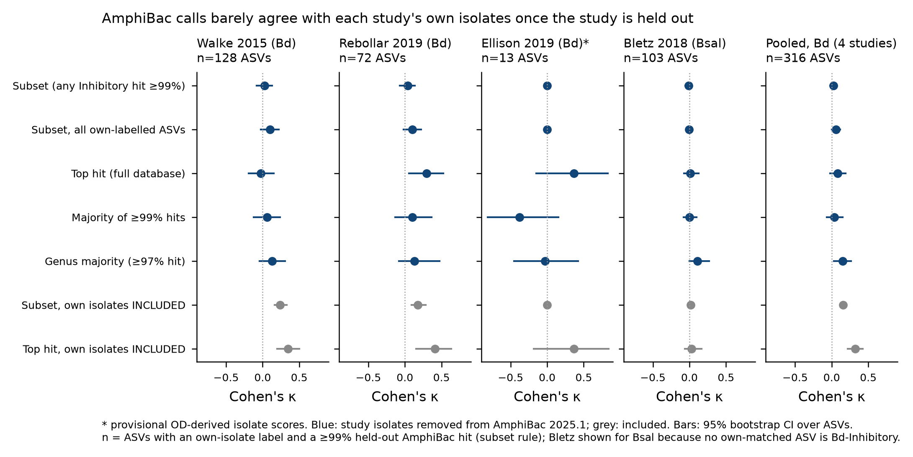

# Paired-study test: does AmphiBac agree with each study's own isolates?

**Question.** In studies that both cultured and sequenced, the study's own Bd-assayed isolates give a label for some of its own ASVs. Does the pipeline's call for those ASVs agree once the study's isolates are removed from AmphiBac?

**Data.** Eight curated paired studies were considered ([paired_culture_amplicon_studies.xlsx](../tables/paired_culture_amplicon_studies.xlsx)). Four were usable at sequence level:
- **Walke 2015/2017:** 719 scored isolates. The reads are one pooled file with no sample IDs. The supplied mapping file belongs to the separate bullfrog Bd experiment, so this study is pooled.
- **Rebollar 2019:** 354 scored isolates. Reads were demultiplexed by index read into 61 barcode groups, R01–R61, covering 56% of spots; there are no host labels.
- **Bletz 2018:** 694 isolates with Bd and Bsal assays from Dryad, from the same populations but different swabs.
- **Ellison 2019 (*Mol Ecol*):** 43 isolates from the same swabs. Scores were derived from the raw OD data and are provisional; per-sample Bd is available.

The other studies were not usable: Jiménez 2019 has no isolate sequences, the *PNAS* 2019 isolates have no antifungal assays, and Assis 2020 gives only genus-level calls.

**Methods.**
- **ASVs:** a uniform 150-nt V4 window after 515F, denoised with vsearch UNOISE3 and uchime3.
- **Own-isolate label:** the majority label (score >80) of the study's isolates covering the whole ASV at 100% identity.
- **Pipeline:** q2-vsearch emulation against AmphiBac 2025.1 with that study's records removed (736, 384, 694 and 0 records respectively). Ellison is not in AmphiBac.

**Results (ASV level, Bd).**

| Rule (study held out) | Walke | Rebollar | Pooled 4 studies |
|---|---|---|---|
| Subset mode (pipeline) | κ 0.02 (−0.09–0.13) | 0.04 (−0.07–0.14) | 0.02 (−0.02–0.07) |
| Top hit | −0.03 | 0.30 (0.06–0.52) | 0.08 |
| Majority of ≥99% hits | 0.06 | 0.10 | 0.04 |
| Genus majority | 0.13 | 0.13 | 0.15 (0.03–0.27) |
| *Subset, own isolates included* | *0.24* | *0.18* | *0.15* |
| *Top hit, own isolates included* | *0.35* | *0.41* | *0.32* |

- **Held out, the pipeline barely agrees with the study's own isolates.** Subset mode catches most own-Inhibitory ASVs (sensitivity 0.85 pooled) but calls most non-inhibitors Inhibitory too (specificity 0.20, PPV 0.20).
- **Including the study's own isolates roughly doubles κ** (pooled top hit 0.08 → 0.32). Much of the apparent agreement when a lab analyses its own data with AmphiBac is circular: the ASVs match the lab's own deposited isolates.
- **Genus does at least as well as any sequence rule**, matching the cross-study results in sections 6 and 8h.
- **Bletz 2018 is uninformative for Bd.** Only 3 of 694 isolates score >80, and no own-matched ASV is Bd-Inhibitory. For Bsal, held-out κ is −0.01 to 0.11, but only about 3 own-Inhibitory ASVs exist.
- **Ellison 2019 is too small to judge:** 13 ASVs, with κ ranging from −0.38 to 0.37 across rules.

**Coverage.** A study's own isolates cover a minority of its reads: 37% (Walke, pooled), 20% (Rebollar), 22% (Bletz) and 3% (Ellison). AmphiBac ≥99% hits from other studies cover 51–64%. So the pipeline mostly labels reads using isolates from other labs and other hosts.

**Per sample.** The pipeline's inhibitory proportion is unrelated to the inhibitory proportion from the study's own isolates:
- Rebollar: ρ = 0.00 (60 groups).
- Ellison: ρ = −0.12 (98 samples).
- Bletz, against the Bsal-based own proportion: ρ = −0.07.

**Bd (Ellison 2019, 87 frogs, 56 infected).**
- **Pipeline metric:** not related to infection status (OR per SD 0.97 after site and life stage, p = 0.93). Its slope on load among infected frogs is +0.34 per SD (p = 0.06).
- **Own-isolate metric:** inhibitory proportion and mean score were associated with *higher* load before adjustment (p = 0.005 and 0.03). Neither association remained after site and life stage (p = 0.72 and 0.97).
- **Bletz 2018:** in Experiment 1 (6 exposed vs 6 control, Mann–Whitney), the Bd-based metrics did not differ (p ≥ 0.70). The own-isolate Bsal-inhibitory proportion after exposure was nominally higher in exposed animals (median 0.051 vs 0.022, p = 0.065), but its change from before exposure did not differ (p = 0.82). With n = 12 this is weak evidence.

**Interpretation.**
- Even in the best test case (same animals or populations, same lab assay), AmphiBac calls for an ASV do not reproduce the study's own measurement once that study is held out.
- Agreement in published analyses is inflated when a study's isolates are in the database.

**Caveats.**
- ASVs are treated as independent in the bootstrap intervals.
- The Rebollar groups may include non-study samples, and Walke has no per-sample data.
- Ellison scores are provisional.
- All results use 150-nt V4; Ellison's V3–V4 reads were reduced to merged reads only (28%).

Files: [paired_asv_agreement.xlsx](../tables/paired_asv_agreement.xlsx) (per-ASV calls, agreement, per-sample, Bd tests, Rebollar barcodes, README), [paired_asv_tables.tar.gz](../tables/paired_asv_tables.tar.gz), [paired_analysis_scripts.tar.gz](../scripts/paired_analysis_scripts.tar.gz).

